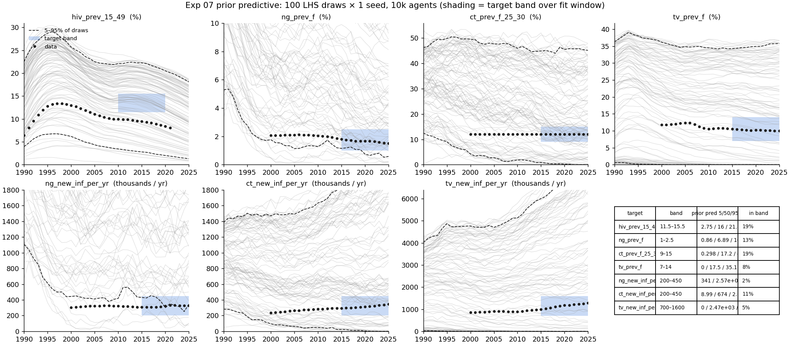
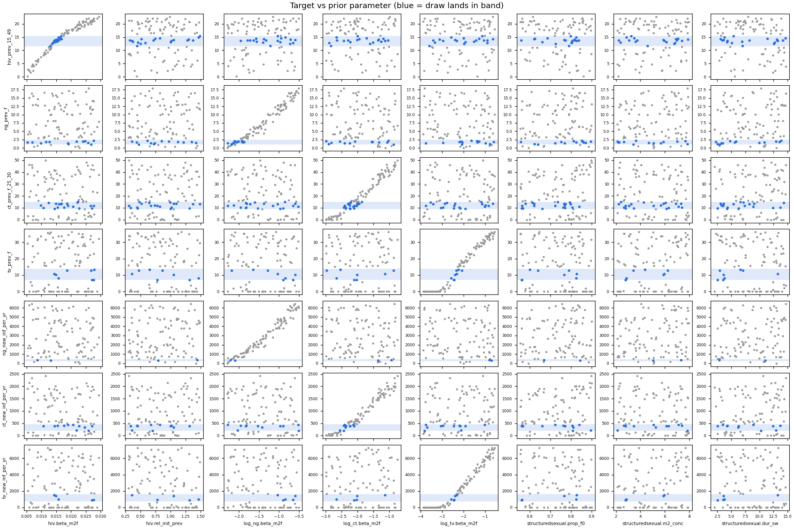

# Exp 07 coverage check — prior predictive for the syphilis-free recalibration

**Date:** 2026-11-24.

**Question.** Before launching the 500-draw exp 07 calibration ([`../07_2026-11-24_no_syph_calibration/run.py`](../07_2026-11-24_no_syph_calibration/run.py)), can the model reach each of the 7 fitted targets under the exp 07 priors?

This is the first run with the gonorrhoea seed fix. Seed infections no longer inherit a NaN `rel_treat`, so NG treatment now cures. The exp 07 instructions pinned plain stisim 1.5.7, which has neither this fix nor exp 04–06's `fix/ng-tx` guard. Under that pin, NG treatment cured no one.

**Result.**
- **Marginal coverage: yes.** Every target band lies inside the 5–95% prior-predictive range.
- **Joint coverage: no, in two ways.**
  1. NG prevalence and NG incidence are never in band together: 0 of the 13 draws with NG prevalence in band. This is structural.
  2. No draw has all three STI prevalences in band at once. That is consistent with each target being fixed by its own beta, but it means a 500-draw LHS over these priors would yield essentially no acceptable draws.

## Method

- 100 draws: the first 100 of exp 07's LHS (seed 47, 500 total). 1 seed per draw, 10k agents, 1985–2026.
- `run.py` calls exp 07's `main()` unchanged, apart from the output directory. Targets, bands, extractors and priors are exactly those exp 07 will use.
- Env `stinotif`: stisim 1.5.7 plus the NG seed fix (branch `v1.5.7-ngseed`); starsim 3.3.2.
- 100/100 sims ok. 912 s on 50 workers, with the VM shared.

## Observations

1. **Each target is set almost deterministically by its own transmission beta** (diagonal of `fig_coverage_params.png`). HIV beta and the network parameters (`prop_f0`, `m2_conc`, `dur_sw`) show no visible effect on the STI targets. So the problem separates by pathogen, and the cross-pathogen joint failure comes from sampling inefficiency, not conflict.

   | target | band | prior pred 5 / 50 / 95% | in band | beta range of in-band draws (prior) |
   |---|---|---|---|---|
   | hiv_prev_15_49 | 11.5–15.5% | 2.8 / 16 / 21.8% | 19% | 0.0130–0.0167 (0.005–0.029) |
   | ng_prev_f | 1–2.5% | 0.9 / 6.9 / 16.4% | 13% | 0.103–0.154 (0.10–0.60) |
   | ct_prev_f_25_30 | 9–15% | 0.3 / 17.2 / 45.7% | 19% | 0.088–0.154 (0.05–0.47) |
   | tv_prev_f | 7–14% | 0 / 17.5 / 35.1% | 8% | 0.076–0.125 (0.02–0.58) |
   | ng_new_inf_per_yr | 200–450k | 341k / 2.6M / 6.0M | 2% | 0.110–0.124 |
   | ct_new_inf_per_yr | 200–450k | 9k / 674k / 2.0M | 11% | 0.078–0.121 |
   | tv_new_inf_per_yr | 700k–1.6M | 0 / 2.5M / 6.8M | 5% | 0.076–0.098 |

2. **NG prevalence and NG incidence conflict.** The 13 draws with NG prevalence in band have incidence of 472–797k/yr, above the 200–450k band. The 2 draws with incidence in band have prevalence of 0.73% and 0.87%, below the 1% floor. Incidence/prevalence is roughly 1/duration of infection. So NG infections in the model are about 1.5–2× shorter than the data's prevalence/incidence pair implies.
   - This is a model or observation-model issue, not a prior issue.
   - Candidates:
     - (a) The data denominators. `ng_prevalence` in `data/zimbabwe_sti_data.csv` is unlabelled by sex but is compared with model `prevalence_f`; this is the open TODO in exp 07's `run.py`.
     - (b) NG natural history or care-seeking now that treatment works.
     - (c) The NG incidence series. The file runs to 2040 and looks like a projection, so its source needs confirming.
   - CT (8 of 19) and TV (5 of 8) do reach prevalence and incidence jointly.
3. **NG's in-band beta range sits at the prior floor.** Every draw with NG prevalence in band has beta 0.103–0.154, the bottom ~10% of [0.10, 0.60]. The floor of 0.10 was set in exp 04 to stop NG fading out. With treatment now working, the data want betas at or below it, and the incidence band would push lower still.
4. **Joint acceptance under this prior is tiny.**
   - The fraction of draws in band is 19% (HIV), 13% (NG), 19% (CT) and 8% (TV) for prevalence. If these are independent, about 0.04% of draws land all four in band, so about 0.2 of 500.
   - Observed: 0/100 with all three STI prevalences in band; 2 with NG and CT, 1 with NG and TV, 3 with CT and TV.
   - So the instructions' bar of ≥30 acceptable draws is unreachable as designed, even before NG incidence is counted.
5. **Fade-out happens mainly at low TV beta.** 17/100 draws had TV extinct by 2021–26, all at TV beta below about 0.07, just under the in-band range. NG was extinct in 1 draw and CT in 2.
6. **HIV data overlay caveat.** The data dots are whole-population prevalence (`hiv_prevalence` = n_infected/pop), plotted against model 15–49 prevalence, so the dots sit below the band by construction. The fitted target is the 15–49 band, which is the right comparison.

## Acceptance

Coverage is adequate *marginally* for all 7 targets, so the model can reach each one. It is **not adequate** for launching exp 07 as designed. The NG prevalence/incidence conflict has to be resolved first, and the prior/sampling design must change, or the 500-draw run will return roughly zero acceptable draws.

## Next

Decisions for Robyn (priors and targets are not to be changed without her):
1. **NG targets.** Confirm the NG data source and denominators. Then either drop or down-weight NG incidence, or fit both sexes against an overall prevalence column.
2. **Priors.** Narrow the four transmission betas towards the in-band ranges in the table, keeping a margin, and lower NG's floor below 0.10. Or keep the priors and change the sampler: the problem separates by pathogen, so a short history-matching wave or a per-pathogen beta pre-screen would work.
3. Rerun this coverage check on the revised design before the full exp 07 calibration.
