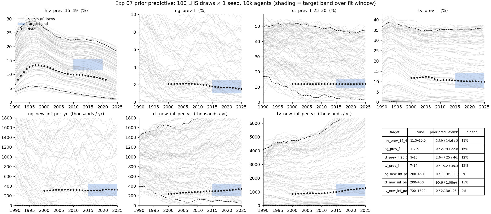
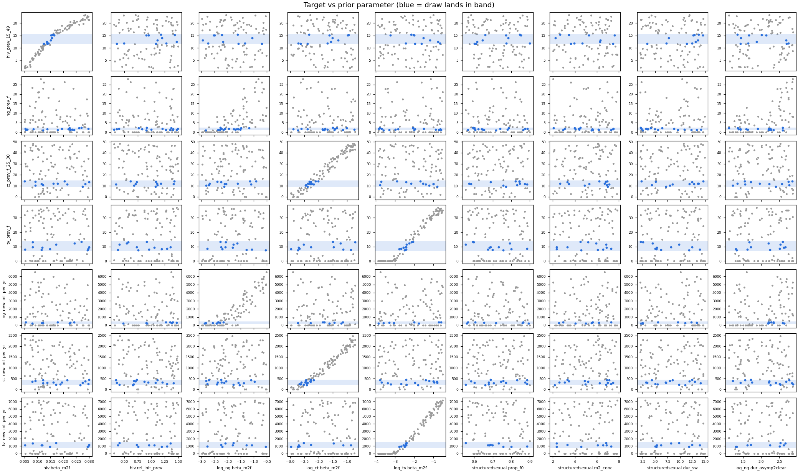

# Exp 07 coverage check, with the NG duration prior

**Date:** 2026-11-24.

**Question.** With `ng.dur_asymp2clear` opened (3–18 months, log-uniform) and NG beta's floor lowered to 0.05, can NG prevalence and NG incidence now be in band together? This follows [`../07_2026-11-24_coverage_check/SUMMARY.md`](../07_2026-11-24_coverage_check/SUMMARY.md), where 0 of 13 draws managed it.

**Result.** Yes. 5 of the 16 draws with NG prevalence in band also have incidence in band. All 5 have untreated asymptomatic durations of 9.0–13.4 months (defaults: F 8, M 6) and beta 0.059–0.115. So the data want *longer* NG infections than the defaults. Every target stays marginally covered.

## Observations

1. **Short durations push incidence up.** Draws with NG prevalence in band and duration of 3–7 months have incidence of 0.70–1.6M/yr. Those at 9–13 months have 0.27–0.64M/yr, against a band of 200–450k.
2. **Marginal coverage holds.** The fraction of draws in band is: HIV 11%, NG prevalence 16%, CT 12%, TV 12%, NG incidence 8%, CT incidence 15%, TV incidence 9%.
3. **NG fade-out is now common.** NG was extinct in 24/100 draws, up from 1/100, because of the low-beta corner (beta < ~0.09 with short durations). The sustainability filter in exp 07 removes these draws.
4. **Joint acceptance across pathogens is still sparse.** Each pathogen is still controlled by its own beta, so the cross-pathogen sampling inefficiency from the first coverage check remains. Expect few acceptable draws from 500.

## Next

Launch the 500-draw exp 07 calibration (10k agents, K=5, to 2030). If it gives fewer than 30 acceptable draws, rerank at `ACCEPT_TOL=1.0` (section 3c of the VM instructions). Then consider narrowing the betas per pathogen.

Run: 100/100 ok, 731 s on 60 workers. Env `stinotif`.
