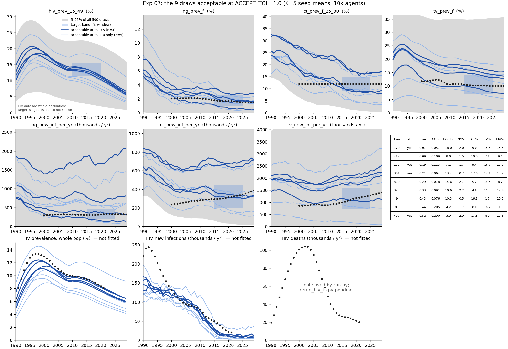

# Exp 07 — syphilis-free calibration (500 LHS draws × K=5)

**Date:** 2026-11-24/25.

**Question.** Does a 500-draw LHS over the exp 07 priors, including the NG duration prior from [`../07_2026-11-24_coverage_check_ngdur/`](../07_2026-11-24_coverage_check_ngdur/SUMMARY.md), give at least 30 draws whose four prevalence targets all lie within `ACCEPT_TOL` band-widths of their bands and which sustain in at least 4 of 5 seeds?

**Result.** No. Only 4/500 draws are acceptable at `ACCEPT_TOL=0.5`, 9 at 1.0 (`rerank.py`) and 33 at 2.0.
- **Why so few:** each prevalence is set almost entirely by its own pathogen's parameters (R² 0.94–1.00). The network parameters add at most 0.02, so they aren't identified by these targets. A draw passes only when all four betas land in their narrow in-band ranges together.
- **Superseded:** the run used all-cause background mortality, which double-counts AIDS deaths, and had migration switched off. Both were fixed afterwards, so this ensemble is not used.

## Observations

1. 2500/2500 sims ok; 12,881 s on 80 workers.
2. Draws failing each prevalence target at tol 1.0: HIV 47%, NG 49%, CT 65%, TV 38%. 250/500 draws fail sustainability, mostly through NG (28% of seeds not sustained) and TV (23%).
3. In-band beta ranges (draws that sustain and are within 0.5 band-widths), min / median / max:

   | Beta | Min | Median | Max |
   |---|---|---|---|
   | HIV | 0.011 | 0.016 | 0.021 |
   | NG | 0.057 | 0.126 | 0.390 |
   | CT | 0.069 | 0.108 | 0.153 |
   | TV | 0.056 | 0.094 | 0.156 |

   NG's duration spans the whole 3–18 month prior.
4. NG incidence is not constrained by the acceptance rule, which uses prevalence only. Draws 497 and 89 (NG duration about 4 months) fit NG prevalence but carry about 1.5–2M NG infections a year.
5. **Population and mortality.** The model population ran up to 11% above the data's implied population by 2020, so every count was inflated. Two causes:
   - `data/zimbabwe_deaths.csv` was UN WPP all-cause mortality: female age-30 rates rise 6× to a 2005 peak, the shape of the AIDS epidemic.
   - `use_migration=False`.

## Next

[Exp 08](../08_2026-11-25_no_syph_calibration_narrow/) (narrowed betas) was started and then stopped. Next: deduplicate the deaths, turn migration on, run a per-pathogen screening run, then build mix-and-match combined draws.
