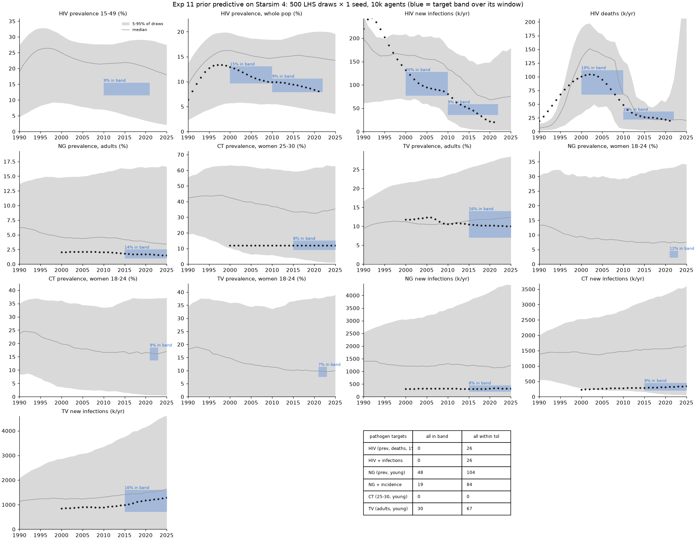
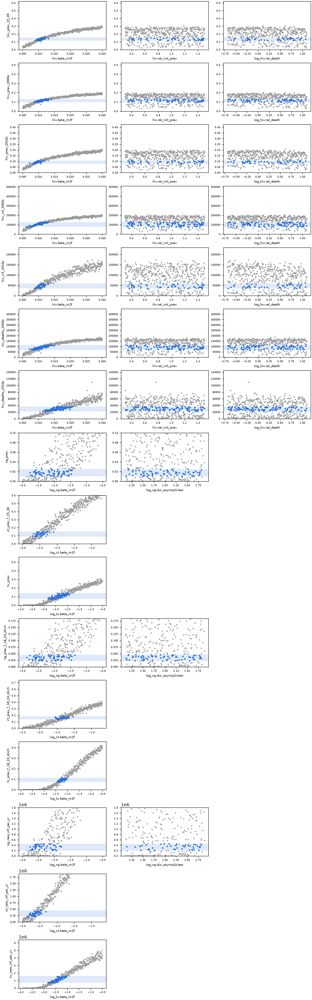

# Exp 11 — coverage check on Starsim 4

**Date:** 2026-11-25.

**Question.** On Starsim 4, can the model reach each of exp 10's 16 targets under its priors? Can it reach them jointly within each pathogen? See `README.md`.

**Result.**
- **Each target separately:** yes. Every band lies inside the 5–95% prior predictive, with 7–20% of draws in band.
- **Within each pathogen:** yes for HIV, NG and TV, but **not for CT**. No draw reaches both the CT target for women 25–30 and STICH's young-women CT.
- **The CT age pattern:** in the model, CT rises with age. Women 18–24 have about half the prevalence of women 25–30 (ratio 0.51, 5–95% 0.29–0.62). The data say the opposite, 1.34 (STICH 16.1% against 12%).
- **The CT 25–30 target is a constant:** 0.12 in every year of `data/zimbabwe_sti_data.csv`, not an IHME time series.

## Observations

1. **Speed.** 500/500 sims ok in 260 s on 150 workers, about 75 s per sim at 10k agents to 2026. That's about 5× faster than stisim 1.5.7.

2. **Joint coverage by pathogen.** Columns: all targets in band; all within their acceptance tolerance.

   | Group | In band | Within tolerance |
   |---|---|---|
   | HIV (15–49, whole-pop prevalence, deaths) | 0 | 26 |
   | HIV, adding infections | 0 | 26 |
   | NG (adults, young women) | 48 | 104 |
   | NG, adding incidence | 19 | 84 |
   | CT (women 25–30, young women) | 0 | 0 |
   | TV (adults, young women) | 30 | 67 |

3. **CT's age pattern is the model's, not the port's.**
   - With default parameters, v3 and v4 give the same shape of CT prevalence in women: 2.5% at 15–20, 15–20% at 20–25 and 22–33% at 25–30.
   - They also give the same share of women currently partnered: 20% at 15–20, 70% at 20–25 and 85–90% at 25–30.
   - Among draws with CT 25–30 in band (41), young-women CT is 2–7%, against STICH's 13.7–18.5%.
   - Among draws with young-women CT in band (43), CT 25–30 is 28–39%, against the target's 9–15%.
   - NG's young women are at about 2× all adults, and TV's at 0.8×.

4. **HIV deaths can now be fitted.** The 2000s and 2010s death bands each contain about 20% of draws. A late rise in deaths (95th percentile over 200k/yr by 2025) comes from draws whose HIV prevalence is far too high: about 3M people living with HIV against 1.19M on ART, which holds at its last value. That's not an input bug: `n_art.csv`'s trailing blank 2022 row holds the 2021 value.

5. **Validation (prior predictive, not calibrated):**
   - CT, NG or TV among pregnant women: median 46% (17–60%), against PROMISE's about 27%.
   - Share of those infections that are symptomatic: 20% (8–26%), against PROMISE's under 10%.
   - CT, NG or TV among women 18–24: 34% (10–46%), against STICH's 25.0%.

## Next

- **CT targets:** a decision for Robyn. The two CT targets can't be met together under the model's age structure. Options:
  - drop the constant 0.12 CT 25–30 target and fit CT to STICH's young women alone;
  - widen it;
  - change the network's age pattern of partnership, which is a model change.
- **Then the mix-and-match calibration** (`../12_2026-11-25_mix_and_match/`) from per-pathogen pools: HIV within tolerance 26, NG 84, TV 67, and CT once decided.
