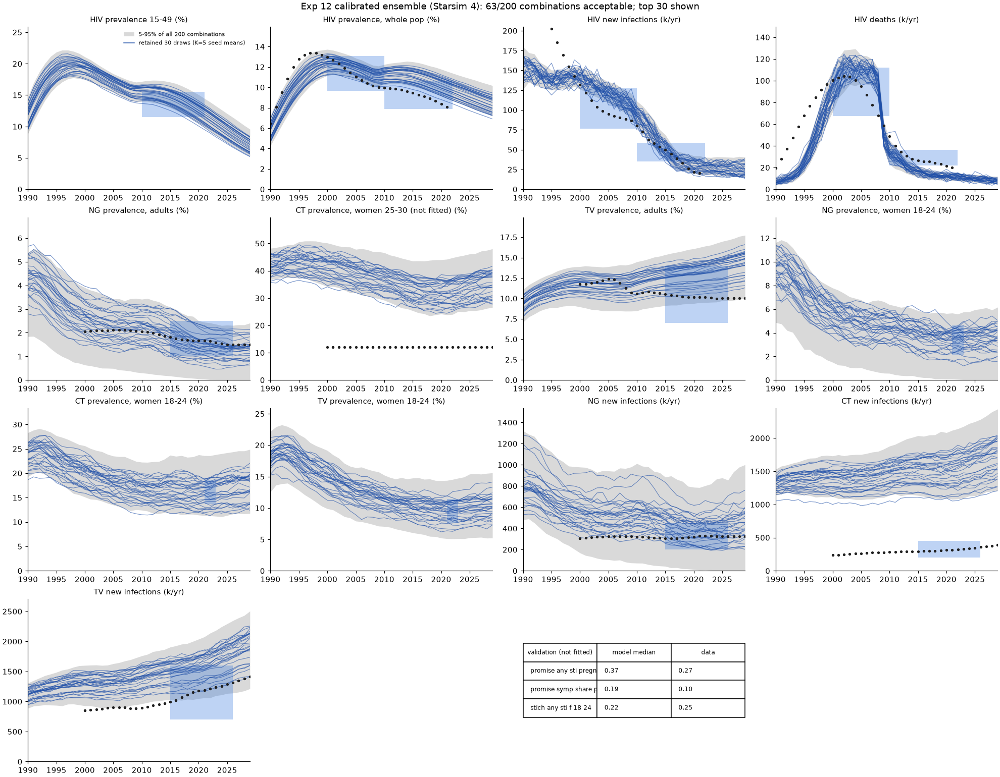

# Exp 12 — mix-and-match calibration on Starsim 4

**Date:** 2026-11-25.

**Question.** Combine per-pathogen parameter sets from exp 11's screen and run them at K=5 against exp 10's targets (CT fitted to STICH's young women alone). Does that give at least 30 acceptable draws? See `README.md`.

**Result.**
- **Yes:** 63 of 200 combinations are acceptable, and the top 30 by goodness of fit are retained (`outputs/draws_used.csv`).
- **The couplings are weak:** each target's failure rate across all 200 combinations is 0–24%. 86% of combinations sustain every disease in 5 of 5 seeds.
- **The ensemble draws on** 17 different HIV source draws and 25–27 for each STI.

## Observations

1. **Run.** 1000/1000 sims ok, 566 s on 150 workers (10k agents, 1985–2030). Pools from exp 11: HIV 26, NG 84, CT 102, TV 67 draws.

2. **Failure rate per acceptance target**, across all 200 combinations:

   | Target | Failure rate |
   |---|---|
   | CT, young women | 24% |
   | TV, young women | 19% |
   | NG, young women | 18% |
   | HIV deaths, 2010s | 14% |
   | NG incidence | 12% |
   | NG, adults | 10% |
   | HIV prevalence, 2010s | 9% |
   | HIV 15–49 prevalence; HIV prevalence and deaths, 2000s; TV, adults | 0% |

3. **Retained 30**, min / median / max against band:

   | Target | Min / median / max | Band |
   |---|---|---|
   | HIV 15–49 (2010–20) | 12.3 / 14.6 / 15.9% | 11.5–15.5 |
   | HIV whole population, 2000s | 10.7 / 12.0 / 12.5% | 9.7–13.1 |
   | HIV whole population, 2010s | 9.6 / 11.0 / 11.8% | 7.9–10.6 |
   | HIV infections, 2000s | 111 / 124 / 133k | 77–128 |
   | HIV infections, 2010s | 39 / 52 / 63k | 35–59 |
   | HIV deaths, 2000s | 90 / 100 / 110k | 67–112 |
   | HIV deaths, 2010s | 15 / 18 / 27k | 22–36 |
   | NG, adults | 0.67 / 1.55 / 2.45% | 1.0–2.5 |
   | NG, women 18–24 | 1.6 / 3.6 / 4.5% | 2.2–4.6 |
   | NG infections | 225 / 401 / 680k | 200–450 |
   | CT, women 18–24 | 11.5 / 16.3 / 19.0% | 13.7–18.5 |
   | TV, adults | 10.5 / 13.3 / 14.9% | 7–14 |
   | TV, women 18–24 | 6.3 / 9.9 / 12.3% | 7.6–11.5 |

4. **HIV's shape.**
   - **Starts too slowly:** in the early 1990s infections are about 145k against 200k+, and deaths are far below the data.
   - **Falls too sharply:** HIV deaths drop around 2009–10, where the data decline gradually.
   - **Low after 2015:** 2015–20 deaths are 10–20k against the data's 22–26k, at the low edge of tolerance.
   - **Prevalence:** whole-population prevalence in the 2010s is at the band's upper edge.
   - **Possible levers:** the early-epidemic parameters (`rel_init_prev`, which reaches 1.5, or the seeding), and the ART scale-up and on-ART mortality.

5. **CT and TV incidence are high** (ranking score only, weight 0.5).
   - CT is 1.1–1.8M/yr against IHME's 200–450k, and TV 1.2–1.9M against 0.7–1.6M.
   - CT among women 25–30, no longer fitted, is 30–40%, against the file's constant 12%.
   - CT's incidence/prevalence ratio is high, the signature of short infections. That's the same pattern NG showed before its duration prior (exp 07 coverage check).

6. **TV among adults rises after 2015**, to 12–16% by 2025, while the IHME series is flat at about 10%.

7. **Validation** (not fitted), retained 30, median (min–max):

   | Measure | Model | Data |
   |---|---|---|
   | CT, NG or TV among pregnant women | 37% (33–41%) | PROMISE about 27% |
   | Share of those infections symptomatic | 19% (17–21%) | PROMISE under 10% |
   | CT, NG or TV among women 18–24 | 22% (18–25%) | STICH 25.0% |

   The model is high for pregnant women and slightly low for young women.

## Acceptance

The ensemble is usable for the scenario factorial. It fits every accepted target within tolerance. Caveats for the paper:
- CT and TV incidence are above IHME (observation 5).
- HIV mortality runs low after 2015 (observation 4).
- CT, NG or TV among pregnant women is higher than PROMISE suggests (observation 7).

## Next

- Port `run_scenarios.py` to v4 and run the scenario smoke, with DRAWS = `outputs/draws_used.csv`.
- Validate v4 against v3 pathway by pathway: PN, and POC false positives.
- Consider opening CT's untreated duration, as for NG, to bring CT incidence down. A decision for Robyn.
