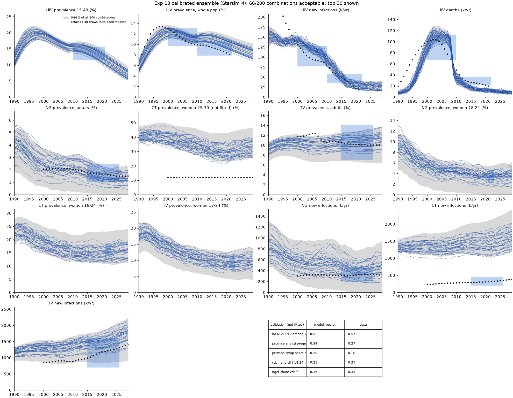

# Exp 13 — calibration with non-STI VDS presentations matched to Chirenje 2018

**Date:** 2026-11-25.

**Question.** With SimpleBV (every non-STI cause of vaginal discharge) clearing every episode (`p_clear=1`), and a target on the presenter mix, does exp 12's set of combinations still fit? Does the mix of women presenting with VDS match the Zimbabwe STI Etiology Study? See `README.md`.

**Result.**
- **Yes:** 66 of 200 combinations are acceptable (exp 12: 63), and the top 30 are retained (`outputs/draws_used.csv`; `run_scenarios.py` now defaults to them).
- **No NG/CT/TV among female VDS presenters:** 52.8% median (50.2–58.0%) across the retained draws, against Chirenje's about 57% (band 50.6–64.4%). In exp 12 it was about 15%.
- **NG or CT among presenters:** 35.7% (28.9–41.4%), against about 33%.

## Observations

1. **Run.** 1000/1000 sims ok, 579 s on 150 workers.

2. **Why exp 12 was wrong.** Half of SimpleBV's episodes persisted for 100 years (stisim's default `p_clear=0.5`). So most women with non-STI discharge presented once in a lifetime, and the presenters were 85% NG/CT/TV-positive. The v3 runs hid this: their SimpleBV re-presented every month (stisim #616), and the "62% BV alone" figure was a snapshot of symptomatic women, not presenters.

3. **Screen** (2 draws, SOC, 2015–25). Share of presenters with no NG/CT/TV:

   | `p_symp_care` | `p_clear` | No NG/CT/TV |
   |---|---|---|
   | 0.3 | 0.5 | 14% |
   | 0.3 | 0.8 | 25% |
   | **0.3** | **1.0** | **60%** (adopted) |
   | 1.0 | 0.8 | 53% |
   | 1.0 | 1.0 | 78% |

   NG prevalence barely moves (1.4% to 1.3%).

4. **Retained fit, against exp 12:**
   - NG among adults: 0.6 / 1.4 / 2.4%.
   - CT, young women: 11.5 / 14.8 / 18.1%.
   - TV among adults: 8.4 / 10.8 / 12.7% (exp 12: median 13.3%, now closer to IHME's flat 10%).
   - HIV unchanged: 2010s prevalence 9.6–11.8%, deaths 15–23k.

5. **Validation**, retained 30 medians:

   | Measure | Model | Data |
   |---|---|---|
   | CT, NG or TV among pregnant women | 34% (exp 12: 37%) | PROMISE about 27% |
   | Share symptomatic | 20% | PROMISE under 10% |
   | CT, NG or TV among women 18–24 | 21% | STICH 25% |

6. **Caveats carried from exp 12:**
   - CT incidence is about 4× IHME, and TV incidence is high.
   - HIV deaths after 2015 run low.
   - HIV starts too slowly in the early 1990s.

## Next

- The full factorial on this ensemble is running (`results/scenarios_run_v4b.log`).
- Then `process_results.py` and `analysis/fp_harms.py`, and the manuscript's headline numbers.
